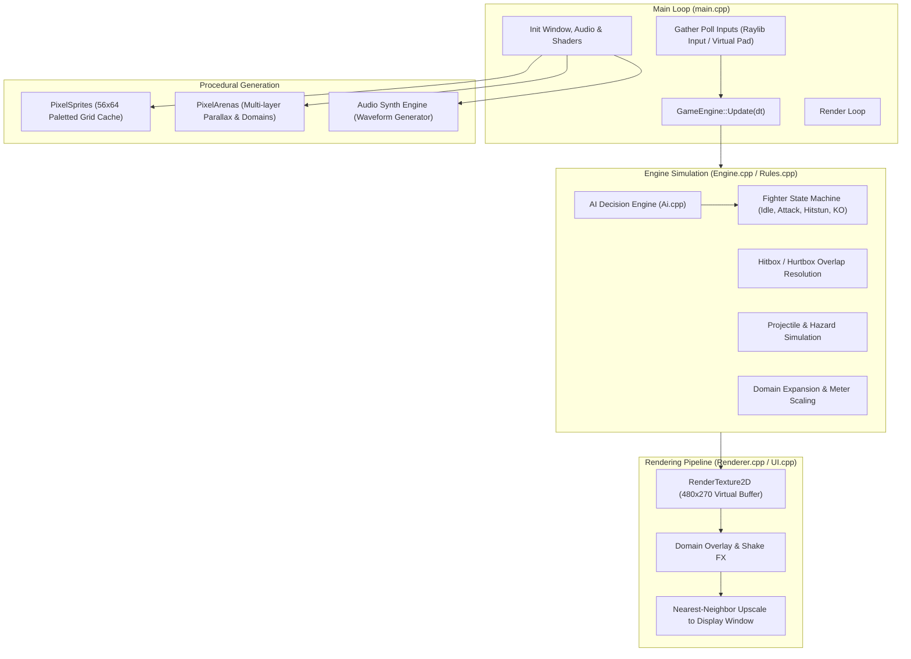

# Jujutsu Kaisen: Cursed Clash — Architecture & Technical Specifications

> **System Overview & Technical Design Document**  
> *Project:* Jujutsu Kaisen: Cursed Clash (Native C++17 & Raylib Engine + React/TypeScript Reference Implementation)  
> *Target Resolution:* Virtual 480x270 viewport scaled to arbitrary resolutions (Default 960x540)  
> *Frame Rate Target:* Fixed 60 FPS update / Variable render  

---

## 1. System Overview

**Jujutsu Kaisen: Cursed Clash** is a 2D arcade fighting game featuring Jujutsu sorcerers and cursed spirits. The project contains two implementations:
1. **Native C++ Engine (`cpp/`):** High-performance, zero-external-asset native implementation using C++17 and Raylib. Sprites, arena backgrounds, UI, and audio effects are generated algorithmically at runtime.
2. **Web / Reference Prototype (`JJK-Game/`):** React, TypeScript, HTML5 Canvas, and Vite prototype.

### Core Philosophy
* **Self-Contained & Deterministic:** No external runtime media dependencies (textures, `.wav`/`.mp3` files, or asset packs). Everything is procedural, allowing instantaneous zero-IO loading.
* **Pixel-Crisp Presentation:** Internal logic executes on a 480x270 canvas, rendered to an offscreen target and upscaled using nearest-neighbor filtering (`TEXTURE_FILTER_POINT`) to preserve pixel art fidelity.
* **Fighting Game Discipline:** Fixed delta-time physics, discrete animation frames, frame-advantage hitstun/blockstun, active startup/recovery windows, and hurtbox/hitbox collision checks.

---

## 2. System Architecture



---

## 3. Core Engine Specifications

### 3.1 Display & Coordinate System
* **Virtual Resolution:** `480 × 270` pixels (`WORLD_WIDTH`, `WORLD_HEIGHT`).
* **Stage Bounds:**
  * `STAGE_LEFT`: `24.0f`
  * `STAGE_RIGHT`: `456.0f`
  * `GROUND_Y`: `232.0f` (Baseline floor)
* **Default Display Window:** `960 × 540` (2x integer scale, resizable).
* **Scaling Strategy:** Render to a fixed `RenderTexture2D`, blit to screen with destination rectangle maintaining aspect ratio and letterboxing if necessary.

### 3.2 Physics & Timings
* **Tick Rate:** 60 Hz fixed timestep (`dt = 1.0f / 60.0f`).
* **Round Timer:** 99.0 seconds standard round clock.
* **Gravity:** Standard jump and air trajectory acceleration.
* **Hitstop / Impact Freeze:** 2–6 frames of freeze on heavy impacts to provide tactile hit weight.

---

## 4. Combat Mechanics & Frame Data

### 4.1 Fighter State Machine
Every fighter transitions between distinct combat states:
* `Idle`, `WalkForward`, `WalkBackward`, `Jump`, `Dash`, `Sidestep`
* `Block`, `Parry` (precise startup timing, grants frame advantage)
* `Light1`, `Light2`, `Light3` (combo chain cancel windows)
* `Heavy` (launcher / wall-bounce property)
* `Special` (unique character technique, cursed energy cost)
* `Ultimate` (cinematic domain expansion / max output move)
* `Hitstun`, `Knockdown`, `KO`

### 4.2 Combat Hit Calculations
1. **Combo Scaling:** Consecutive hits in a combo scale damage (`damage = base_damage * pow(0.85, combo_count)`).
2. **Parry Window:** Deflect active for a narrow window (typically 6–10 frames). Successful deflect negates damage, grants cursed energy, and induces attacker recovery freeze.
3. **Guard Gauge & Shield Break:** Blocking sustained heavy attacks depletes guard meter, causing guard crush and vulnerable stun.
4. **Cursed Energy & Domain Gauge:**
   * Cursed energy accumulates through dealing/taking damage and successful parries.
   * Max meter triggers **Domain Expansion**, altering the arena backdrop, playing signature audio themes, and enabling sure-hit or buff mechanics.

---

## 5. Procedural Generation Specifications

### 5.1 Sprite Engine (`PixelSprites`)
* **Dimensions:** 56x64 procedural pixel raster per character animation frame.
* **Palette Encoding:** Discrete color indices mapped to fighter themes (e.g., Gojo: white hair, blue eyes, dark navy uniform, red/blue aura).
* **Cache:** Frame bitmaps generated once into GPU textures at startup to maintain zero runtime allocation during gameplay.

### 5.2 Arena Backgrounds (`PixelArenas`)
* **Layering:** Multi-layer parallax (Sky, Far Scenery, Midground Architecture, Foreground Ground).
* **Dynamic Overlays:** Domain Expansion activates animated procedural domain patterns (e.g., *Infinite Void* cosmic geometry, *Malevolent Shrine* cursed waters and bone shrines).

### 5.3 Audio Synthesis Engine (`Audio`)
* **Buffer Generation:** Uses Raylib's `Wave` structure to create 16-bit PCM waveforms procedurally.
* **Wave Types:**
  * Square & Sawtooth: Arcade style hits and menu beeps.
  * White Noise + Low Pass: Heavy impacts, explosions, cursed surges.
  * Sine Modulation & FM: Energy hums, domain expansion resonant drones.

---

## 6. Fighter Roster Specification

| Character | Role / Archetype | Signature Techniques | Domain Expansion / Ultimate |
| :--- | :--- | :--- | :--- |
| **Satoru Gojo** | Space Control / Rushdown | Limitless, Lapse: Blue, Reversal: Red | *Infinite Void* (Massive stun + sure-hit) |
| **Ryomen Sukuna** | High Damage / Pressure | Dismantle, Cleave, Fire Arrow | *Malevolent Shrine* (Continuous cutting field) |
| **Yuta Okkotsu** | Adaptable / Balanced | Cursed Speech, Katana Strike, Rika Claw | *Authentic Mutual Love* |
| **Megumi Fushiguro** | Summoner / Zoning | Divine Dog, Nue, Great Serpent, Toad | *Chimera Shadow Garden* |
| **Kento Nanami** | Precision / Critical Striker| Ratio Technique (7:3 strike), Overtime | *Overtime Max Output* |
| **Toji Fushiguro** | Anti-Sorcerer / Rushdown | Inverted Spear of Heaven, Playful Cloud | *Heavenly Restriction Zero CE Rush* |
| **Mahito** | Shape-shifter / Mixup | Soul Repulsion, Body Blades | *Self-Embodiment of Perfection* |
| **Suguru Geto / Kenjaku**| Swarm / Trap | Maximum: Uzumaki, Cursed Spirit Swarm | *Womb Profusion* |

---

## 7. Controls & Input Mapping

| Action | Primary Keyboard | Secondary Keyboard | Gamepad Binding |
| :--- | :--- | :--- | :--- |
| **Move Left / Right** | `A` / `D` | `Left` / `Right` Arrow | D-Pad / Left Stick X |
| **Jump** | `W` | `Up` Arrow | Button South / A |
| **Crouch / Dodge** | `S` | `Down` Arrow | D-Pad Down |
| **Dash** | `Space` | `Double Tap Direction` | Left Trigger |
| **Block** | `L` | `Right Shift` | Left Bumper / Right Trigger |
| **Parry / Deflect** | `Q` | `F` | Right Bumper |
| **Light Attack Combo**| `J` | `Z` | Button West / X |
| **Heavy Attack** | `K` | `X` | Button North / Y |
| **Special Technique** | `U` | `C` | Button East / B |
| **Domain / Ultimate** | `I` | `V` | Left + Right Trigger |
| **Pause** | `Escape` | `Enter` | Start / Options |

---

## 8. Directory & Source Layout

```
.
├── docs/
│   └── SPECS.md            # Complete architecture & design specifications (This file)
├── Makefile                # Top-level build file
├── bin/
│   └── cursed_clash        # Compiled binary executable
├── cpp/
│   ├── CMakeLists.txt      # CMake build definitions
│   ├── Makefile            # Native C++ compiler rules
│   ├── include/            # Header declarations
│   │   ├── Types.hpp       # Data models, enumerations, state definitions
│   │   ├── Rules.hpp       # Combat rules, collision detection, combo math
│   │   ├── Roster.hpp      # Character profiles and stage configurations
│   │   ├── PixelSprites.hpp# Procedural character rasterizers
│   │   ├── PixelArenas.hpp # Procedural arena rendering
│   │   ├── Audio.hpp       # Procedural audio synthesis
│   │   ├── Ai.hpp          # State machine enemy behavior
│   │   ├── Engine.hpp      # Simulation orchestrator
│   │   ├── Renderer.hpp    # 2D frame drawing & shader post-processing
│   │   └── UI.hpp          # HUD, menus, fighter dialogue
│   └── src/                # Implementation files
└── JJK-Game/               # TypeScript & React web reference prototype
```

---

## 9. Verification & Build Commands

```bash
# Compile native binary via root Makefile
make

# Execute native game
make run

# Run headless simulation test
make test

# Clean artifacts
make clean
```
